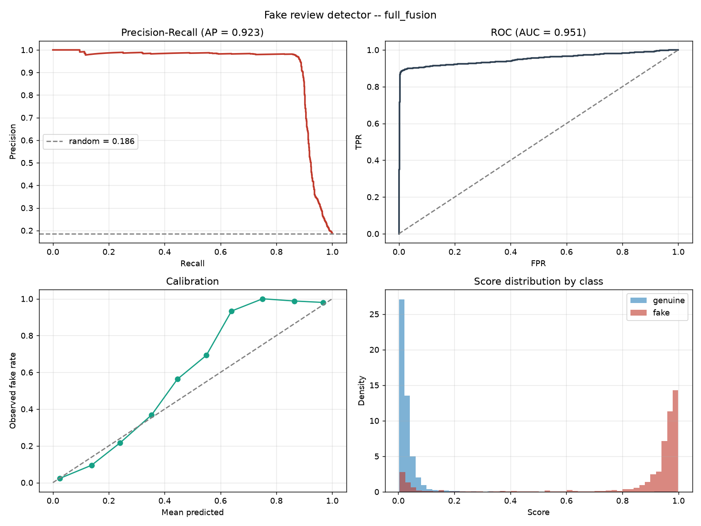

# Fake Review Detector

Detects paid, incentivised, and machine-generated reviews on an e-commerce
marketplace. Fuses **what a review says** with **how it arrived** — because a
single glowing 5-star post is unremarkable, while forty of them on one product
inside six hours from accounts that each post four reviews a day is not.

Runs end to end on a laptop with no data downloads: a synthetic marketplace
generator ships with the project, and real corpora plug in through one adapter.

```
Review text ──▶ TF-IDF word+char ──▶ LogisticRegression ──▶ text_score ──┐
                                                                          ├──▶ GBDT ──▶ calibrated P(fake) ──▶ tiered action
Reviewer & product history ──▶ 31 causal behavioural features ────────────┤
Review text ──▶ 46 linguistic/stylometric features ──────────────────────┘
```

---

## Quickstart

```bash
make setup      # venv + editable install  (macOS also: brew install libomp)
make dataset    # synthesise 40k reviews with embedded review-farm campaigns
make train      # 5 ablations x 2 split regimes; saves the best model
make test       # 69 tests, including the no-leakage proof
make serve      # scoring API on :8000, interactive docs at /docs
```

Score one review from the command line:

```bash
.venv/bin/python -m frd.cli.score --text "Amazing product! Best ever! Highly recommend!"
```

---

## Results

40,000 synthetic reviews · 19.3% inauthentic · 6,027 accounts · 891 products ·
**temporal split** (train on the past, test on the future) · 28k train / 6k val
/ 6k test.

### The ablation is the interesting part

| Model | Features | Test PR-AUC | P@2% | Precision | Recall |
|---|---|---|---|---|---|
| `text_only` | TF-IDF word + char | 0.837 | 0.975 | 0.926 | 0.759 |
| `linguistic_only` | 46 stylometric | 0.837 | 0.975 | 0.904 | 0.719 |
| `behaviour_only` | 31 causal behavioural | **0.911** | 0.983 | 0.898 | 0.872 |
| `text_plus_linguistic` | both text families | 0.858 | 0.950 | 0.898 | 0.786 |
| **`full_fusion`** | **all three** | **0.923** | **0.992** | **0.905** | **0.892** |

Random-ranking PR-AUC is 0.186, so the fused model is a **4.97× lift**;
ROC-AUC 0.951, Brier 0.027.

**The finding that matters: behaviour alone (0.911) beats both text families
combined (0.858).** *How* a review arrived carries more signal than what it
says — which is why the causal-feature machinery exists and why the no-leakage
proof is load-bearing. Fusion still wins, so text is not redundant; it is the
weaker half.

Sanity check on the same data with a **cold-reviewer** split (no account shared
between train and test): fused PR-AUC 0.912. Performance survives unseen
accounts, so the model is not a memorised blocklist.

### Choosing an operating point

Per 10,000 reviews/day, on test:

| Threshold | Precision | Recall | Flagged/day | False accusations/day | Missed fakes/day |
|---|---|---|---|---|---|
| 0.10 | 0.843 | 0.900 | 1980 | 310 | 187 |
| 0.15 | 0.905 | 0.893 | 1833 | 175 | 198 |
| **0.30** | **0.959** | **0.882** | **1707** | **70** | **220** |
| 0.50 | 0.977 | 0.867 | 1648 | 38 | 247 |
| 0.90 | 0.980 | 0.757 | 1433 | 28 | 452 |

Moving 0.15 → 0.30 removes 105 false accusations a day and costs 22 extra
misses. That is the trade the threshold policy exists to make explicit.

Queue quality at the top is high: **P@1% = 1.000, P@2% = 0.992, P@5% = 0.987** —
if moderators can only review the top 5% of daily volume, essentially all of it
is fraud.

### Where it fails (the slices that matter)

| Slice | n | Base rate | PR-AUC | Lift | Recall |
|---|---|---|---|---|---|
| Author has 3–9 prior reviews | 2257 | 0.401 | 0.970 | 2.4× | 0.960 |
| Author has 1–2 prior reviews | 668 | 0.130 | 0.851 | 6.5× | 0.805 |
| **Author has no history (cold)** | 197 | 0.056 | **0.453** | 8.1× | **0.364** |
| **Author has 10+ reviews** | 2878 | 0.038 | **0.510** | 13.3× | **0.455** |
| Verified purchase | 4202 | 0.092 | 0.821 | 8.9× | 0.772 |
| Not verified | 1798 | 0.405 | 0.969 | 2.4× | 0.956 |
| 2–3 star rating | 1949 | 0.055 | 0.696 | 12.7× | 0.645 |

Read **lift**, not raw PR-AUC, across these rows — 0.45 on a 5.6%-positive
slice is 8× better than random, while 0.45 on a 40%-positive slice would be
worse than random. Three honest weaknesses:

1. **Cold start.** No author history → behavioural features are sentinels and
   recall falls to 0.36. Graph features (ROADMAP phase 7) are the answer.
2. **Established-looking accounts.** Recall 0.455 at 10+ prior reviews: a farm
   that patiently ages its accounts defeats the burst signals.
3. **Verified fakes.** Refund-for-review schemes produce *verified* purchases;
   PR-AUC drops from 0.969 to 0.821 when the verified badge is present.

None of these are visible in the headline number, which is why the slice table
is generated on every run.

**A false-positive check worth doing.** Because "no prior history" correlates
with fraud in training, there is a real risk the model flags every genuine
first-time reviewer. Measured directly, holding text constant and varying only
the supplied history:

| Author context | Specific/measured text | Promotional text |
|---|---|---|
| None (cold start) | 0.034 | 0.986 |
| 3 benign prior reviews | 0.012 | 0.925 |
| 8 benign prior reviews | 0.013 | 0.920 |
| 8 prior, all 5★ unverified | 0.051 | 0.926 |

Cold start adds only ~0.02–0.07, not a dominant penalty: a genuine first review
scores 0.034 against a 0.154 threshold. Text drives the decision, which is the
desired behaviour. `test_genuine_first_time_reviewer_is_not_flagged` locks it
in.



The precision-recall curve holds ~97% precision out to 0.9 recall and then
falls off a cliff, and the score histogram is sharply bimodal. Both say the
same thing: coordinated campaigns are caught almost perfectly, and the
sophisticated lone-wolf fakes are nearly invisible. The average hides two very
different populations.


---

## What makes this more than a text classifier

**1. Behavioural features, computed causally — and proven so.**
The strongest signals are contextual: how fast the author posts, how similar
this text is to their last one, whether the product's review volume just spiked
20×. Computing those wrongly is the single most common way fake-review projects
inflate their results — a reviewer average taken over the whole dataset encodes
the future into the past.

Every feature here may use only reviews *strictly earlier* than the one being
scored. `tests/test_causality.py` recomputes features on a corpus truncated at
row *i* and asserts row *i*'s vector is bit-identical to its value from the full
corpus. A feature that peeked forward fails the test.

**2. No random splits.** A random split puts the same campaign on both sides,
so the model recognises a template it trained on. Two regimes are reported
instead: **temporal** (train on the past, test on the future — the
production-realistic number) and **cold-reviewer** (disjoint accounts — proves
the model is not just a memorised blocklist).

**3. Negative controls.** `tests/test_leakage.py` asserts the pipeline *cannot*
find signal that does not exist: shuffled labels must collapse PR-AUC to the
base rate. Without this, a leakage bug reads as a great result.

**4. The threshold is a policy decision.** Nothing about 0.5 reflects that
wrongly deleting a real customer's review costs more than missing a fake one.
The threshold is set to the lowest value whose validation precision meets a
target (default 90%), and the model emits three tiers — `auto_remove`,
`queue_for_review`, `allow` — with `threshold_table()` printing the whole
frontier as moderator workload per 10k reviews.

**5. Explanations a moderator can act on.** Exact tree-SHAP feature
contributions, exact linear token contributions, and curated English reason
codes:

```json
{
  "score": 0.94, "decision": "auto_remove",
  "reasons": [
    "Author posted 9 reviews in a 24-hour window",
    "Text is 96% similar to another review on this product",
    "Product's review volume is 18.4x its weekly average",
    "Only 12% of the author's past reviews were verified purchases"
  ]
}
```

**6. No training/serving skew.** The API does not reimplement feature logic —
it assembles context plus the target review into a frame and calls the *same*
functions training used. `test_api_and_offline_scores_agree` asserts both paths
return the same number to 1e-6.

---

## Signals the model uses

**Behavioural (31)** — reviewer burst counts (24h/7d/peak), account tenure and
posting rate, rating extremity, template self-similarity, product-review spike
ratio, rating deviation from the product mean, verified-purchase share,
fresh-account share of recent product reviews, overnight-posting share,
category entropy.

**Linguistic (46)** — the core hypothesis is **specificity**. Real customers
cite concrete detail ("measured 31cm not the 29cm listed", "ran 6 hours not the
advertised 9"); paid reviewers produce superlative density with no detail. So
numerals, measurement units, comparatives and hedges count *for* authenticity,
while superlative/intensifier density and stock promo phrases count against it.

**Text** — TF-IDF word (1,2) and character (3,5) n-grams. Character n-grams
matter because farms paraphrase and inject typos specifically to beat
exact-duplicate filters; word n-grams break under those edits, character
n-grams survive them.

---

## Project layout

```
src/frd/
  schema.py               canonical review schema; every source normalises into it
  config.py               all paths and hyper-parameters
  data/
    synth.py              synthetic marketplace with campaigns + label noise
    loaders.py            adapters for real corpora + coverage reporting
    splits.py             temporal and cold-reviewer splits (no random split)
  features/
    behavior.py           31 strictly-backward-looking behavioural features
    text.py               46 stylometric features + TF-IDF vectorisers
  models/
    pipeline.py           two-stage stacked detector, ablation-configurable
    transformer.py        optional DistilBERT stage (lazy imports)
  evaluate.py             PR-AUC, precision@k, threshold frontier, slices
  explain.py              tree-SHAP + token contributions + reason codes
  api/                    FastAPI scoring service
  cli/                    make_dataset / train / score
tests/                    69 tests incl. causality proof + negative controls
docs/
  METHODOLOGY.md          why each decision was made; the leakage analysis
  ROADMAP.md              the phases, what is done, what is next
  MODEL_CARD.md           intended use, limitations, ethical considerations
```

---

## Using real data

```python
from frd.data.loaders import load_generic, describe_coverage

df = load_generic("reviews.csv", column_map={
    "id": "review_id", "asin": "product_id", "author": "reviewer_id",
    "stars": "rating", "body": "text", "created_at": "timestamp",
})
print(describe_coverage(df))   # tells you if behavioural features are usable
```

`describe_coverage` matters: several popular public fake-review corpora have no
reviewer id and no timestamp, so every behavioural feature degenerates to a
constant and you are training a pure text classifier. It says so explicitly
rather than letting you report inflated numbers.

---

## Honest limitations

- **The reported numbers are on synthetic data.** They prove the pipeline is
  correct, causal, and skew-free — not that the model will hit these numbers on
  your marketplace. Re-measuring on labelled production data is Phase 6 of
  `docs/ROADMAP.md`, and the highest-value next step.
- **Cold-start is the weak case.** With no author or product history, behavioural
  features fall back to sentinels and only text remains. The
  `reviewer_history=0` slice quantifies it; graph features are the real answer.
- **Concept drift is guaranteed.** Fraud tactics change; scheduled retraining
  and drift monitoring are not optional.
- **Fairness risk is specific and real.** Terse, unhedged, superlative-heavy
  text is also what a non-native English speaker writes. The specificity
  features could systematically disadvantage them. Measure flag rates by
  writing-style proxy before deploying.

See `docs/METHODOLOGY.md` for the full analysis and `docs/MODEL_CARD.md` for
intended use.
