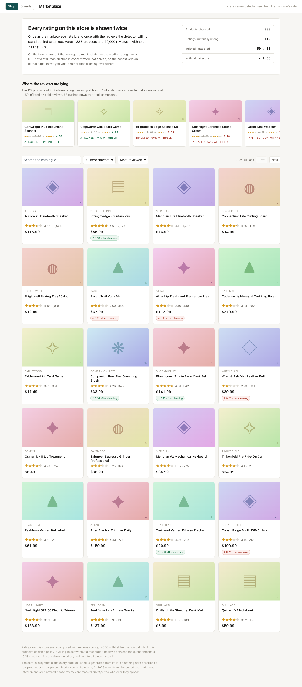
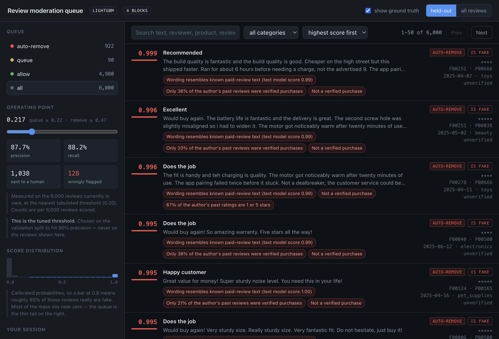
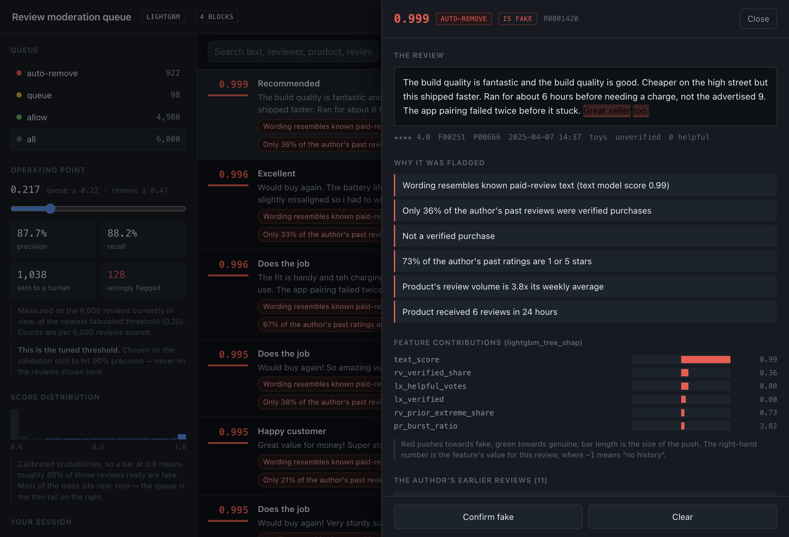
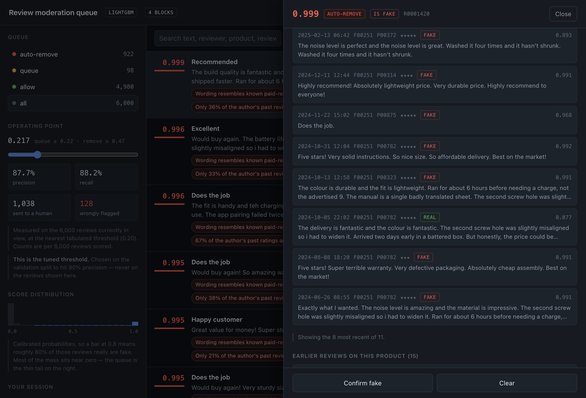

# Fake Review Detector

Detects paid, incentivised, and machine-generated reviews on an e-commerce
marketplace. Fuses **what a review says** with **how it arrived** — because a
single glowing 5-star post is unremarkable, while forty of them on one product
inside six hours from accounts that each post four reviews a day is not.

Runs end to end on a laptop with no data downloads: a synthetic marketplace
generator ships with the project, and real corpora plug in through one adapter.
One command brings up both faces of it — a **storefront** showing every rating
with and without its suspected fakes, and a **moderation console** for triaging
the flags.

```
Review text ──▶ TF-IDF word+char ──▶ LogisticRegression ──▶ text_score ──┐
                                                                          │
Reviewer & product history ──▶ 31 causal behavioural features ────────────┤
                                                                          ├──▶ GBDT ──▶ calibrated P(fake) ──▶ tiered action
Reviewer↔product co-review graph ──▶ 18 causal graph features ────────────┤
                                                                          │
Review text ──▶ 46 linguistic/stylometric features ──────────────────────┘
```

---

## Setup and run

### Prerequisites

| | Version | Notes |
|---|---|---|
| Python | 3.10+ | `python3 -m venv` has to work — on Debian/Ubuntu that means `apt install python3-venv` |
| Node.js + npm | 18+ | only for the moderation console (Vite 6); the model and API need nothing from npm |
| `make` | any | the targets are thin wrappers — [Without `make`](#without-make) has the raw commands |
| OpenMP | optional | LightGBM links against it: macOS `brew install libomp`, Debian/Ubuntu `apt install libgomp1`. Leave it out and training falls back to scikit-learn's `HistGradientBoosting` on its own. |

### The one command

```bash
git clone https://github.com/hrithik73/fake-ai-review-detector.git
cd fake-ai-review-detector
make up
```

Then open <http://localhost:5173>.

`make up` is the whole project from a clean checkout. Each setup step is guarded
by a file check and runs only if it has not been done, then both servers start:

| Step | What it does | Skipped when | Cost |
|---|---|---|---|
| `setup` | creates `.venv`, installs the package editable + dev deps, then LightGBM | `.venv/bin/python` exists | one-off download |
| `dataset` | synthesises 40k reviews with embedded farm campaigns into `data/processed/` | `data/processed/reviews.{parquet,csv}` exists | seconds |
| `train` | 8 ablations × 2 split regimes, saves the best to `artifacts/models/detector.joblib` | that file exists | **a few minutes** |
| `web-setup` | `npm install` in `web/` | `web/node_modules` exists | one-off download |
| `console` | uvicorn on `:8000` and Vite on `:5173` | — | `Ctrl-C` stops both |

So `make up` on a warm tree just starts the servers. Training is the only slow
step and it runs once.

The console's first page load features and scores the whole corpus (~20s for
40,000 reviews) and caches it; the page waits for the API rather than failing
while that happens.

### Step by step

Same thing, driven by hand:

```bash
make setup      # 1. venv + editable install       (macOS also: brew install libomp)
make dataset    # 2. synthesise 40k reviews into data/processed/
make train      # 3. train + evaluate; writes artifacts/models/detector.joblib
make web-setup  # 4. npm install for the console
make console    # 5. API on :8000 + console on :5173
```

Variants worth knowing:

```bash
make train-fast # fused model, temporal split only — for quick iteration
make serve      # scoring API alone on :8000, interactive docs at /docs
make web        # console alone; expects an API already on :8000
make web-build  # production bundle into web/dist
make docker     # serving image; scoring only, model baked in
make help       # every target
```

### Check it worked

```bash
make status
```

```
venv       yes
dataset    data/processed/reviews.csv
model      yes
web deps   yes
API :8000  running
app :5173  running
```

```bash
curl -s localhost:8000/health
# {"status":"ok","model_loaded":true,"backend":"lightgbm","threshold":0.278, ...}

make test      # 100 tests, including the two causality proofs and the negative controls
```

Score one review from the command line:

```bash
.venv/bin/python -m frd.cli.score --text "Amazing product! Best ever! Highly recommend!"
```

```json
{
  "review_id": "inline-1",
  "score": 0.8907,
  "decision": "auto_remove",
  "reasons": [
    "Wording resembles known paid-review text (text model score 0.91)",
    "Not a verified purchase",
    "Unusually high intensifier density (16.7% of words)"
  ],
  "feature_contributions": [ ... ],
  "token_contributions": [ ... ]
}
```

### Stopping, restarting, resetting

```bash
make stop       # kill whatever is left on :8000 or :5173
make up         # warm tree: starts both servers again, no rebuild
make clean      # drop models, reports and figures — the next `make up` retrains
```

### Without `make`

Every target is a one-liner, so nothing here needs it:

```bash
python3 -m venv .venv
.venv/bin/pip install -e ".[dev]"
.venv/bin/pip install lightgbm                 # optional; sklearn fallback if it fails
.venv/bin/python -m frd.cli.make_dataset --source synthetic --n-reviews 40000
.venv/bin/python -m frd.cli.train

.venv/bin/uvicorn frd.api.main:app --port 8000 # terminal 1
cd web && npm install && npm run dev           # terminal 2
```

### Configuration

Defaults work with no environment set; these are the overrides.

| Variable | Read by | Default |
|---|---|---|
| `FRD_MODEL_PATH` | API | `artifacts/models/detector.joblib` |
| `FRD_MODEL_VERSION` | API | `dev` |
| `FRD_DATA_PATH` | API queue | `data/processed/reviews.{parquet,csv}` |
| `FRD_CORS_ORIGINS` | API | `http://localhost:5173,http://127.0.0.1:5173` |
| `FRD_API_URL` | Vite dev-server proxy | `http://127.0.0.1:8000` |
| `VITE_API_BASE` | built console bundle | `/api` |

### Troubleshooting

| Symptom | What it means |
|---|---|
| `Address already in use` on `:8000` or `:5173` | an earlier run is still up — `make stop` |
| `make setup` fails at `python3 -m venv` | the venv module is missing (Debian/Ubuntu: `apt install python3-venv`) |
| LightGBM import error / `libomp.dylib not found` | install OpenMP (`brew install libomp`, `apt install libgomp1`). Training without it silently uses sklearn's booster instead, but a model *already trained* with LightGBM will not load until OpenMP is there. |
| `[dataset] parquet unavailable (...); wrote CSV` | harmless — pyarrow is not installed, so the corpus is CSV. `pip install pyarrow` if you want parquet. |
| CLI says `no model at .../detector.joblib` | run `make train`, or point `--model` at an existing one |
| Console reports a missing model or corpus | `make status` says which; `make train` or `make dataset` |
| Console loads but the queue errors | the API is not up — `curl localhost:8000/health`, or use `make console`, which runs both |

---

## Results

40,000 synthetic reviews · 19.2% inauthentic · 4,968 accounts · 888 products ·
**temporal split** (train on the past, test on the future) · 28k train / 6k val
/ 6k test.

### The ablation is the interesting part

| Model | Features | Test PR-AUC | P@2% | Precision | Recall |
|---|---|---|---|---|---|
| `text_only` | TF-IDF word + char | 0.819 | 0.983 | 0.937 | 0.749 |
| `linguistic_only` | 46 stylometric | 0.832 | 0.975 | 0.893 | 0.691 |
| `behaviour_only` | 31 causal behavioural | **0.888** | 0.983 | 0.867 | 0.769 |
| `graph_only` | 18 causal co-review graph | 0.550 | 0.825 | 0.875 | 0.068 |
| `text_plus_linguistic` | both text families | 0.865 | 0.958 | 0.888 | 0.773 |
| `full_fusion` | text + linguistic + behaviour | 0.924 | 0.992 | 0.901 | 0.878 |
| `behaviour_plus_graph` | behaviour + graph | 0.891 | 0.992 | 0.903 | 0.732 |
| **`full_fusion_plus_graph`** | **all four** | **0.920** | 0.983 | 0.899 | 0.878 |

Random-ranking PR-AUC is 0.172, so the shipped model is a **5.34× lift**;
ROC-AUC 0.958, Brier 0.029.

**The shipped model is chosen on validation, not on this table.**
`full_fusion` scores higher on test (0.924) and `full_fusion_plus_graph`
higher on validation (0.9245 against 0.9227), and validation is what selects —
picking among eight correlated architectures by their test score would make
the headline a maximum over eight draws and leak test into the artifact. This
repo previously did exactly that; see METHODOLOGY §3.6.

**The finding that matters: behaviour alone (0.888) beats both text families
combined (0.865).** *How* a review arrived carries more signal than what it
says — which is why the causal-feature machinery exists and why the no-leakage
proof is load-bearing. Fusion still wins, so text is not redundant; it is the
weaker half.

**The second finding: the graph block's contribution is indistinguishable
from zero.** It has now been measured four times — two corpus draws × two
splits — and reads **−0.0002, +0.0038, +0.0018, −0.0033**. All four are inside
0.004, and the sign is effectively random. It carries 8.8% of stage-B feature
importance while moving the fused score by less than the gap between two
corpus draws.

That is a firmer claim than the one this section used to make ("barely pays"),
and it came out of the sign flip: validation and test disagreed about whether
to ship the block on *both* corpora, in opposite directions, which is how the
selection-on-test bug above got found. An 18-feature streaming union-find that
cannot be shown to help is a cost, and the honest reading is that on this
corpus the behavioural burst features already catch what the graph would,
because a campaign *is* a burst. `graph_only` at 0.550 is the measure of how
little the structure carries alone.

The block stays in the shipped model because validation prefers it, not
because it is proven — and the thing that would settle it is a farm that paces
itself below burst thresholds, which this generator does not yet simulate.
See `docs/ROADMAP.md` phase 7.

**And it does not fix cold start, which is what it was built for.**
`docs/ROADMAP.md` predicted graph features would be the answer to the
no-history slice. Measured, that slice sits at 0.017 PR-AUC with the graph
block in the model — nothing.
The reason is structural and should have been obvious in advance: **an account
with no history has no edges either.** The graph is exactly as empty as the
behavioural counters, for the same reason.

Sanity check on the same data with a **cold-reviewer** split (no account shared
between train and test): fused PR-AUC 0.919. Performance survives unseen
accounts, so the model is not a memorised blocklist. The graph block does
better here than on the temporal split (`graph_only` 0.567 against 0.550),
which is the one result that behaves as the roadmap predicted: structure
generalises to accounts the model has never seen, because it describes the
company an account keeps rather than the account itself.

### Choosing an operating point

Per 10,000 reviews/day, on test:

| Threshold | Precision | Recall | Flagged/day | False accusations/day | Missed fakes/day |
|---|---|---|---|---|---|
| 0.10 | 0.764 | 0.909 | 2052 | 485 | 157 |
| 0.15 | 0.834 | 0.901 | 1862 | 308 | 170 |
| **0.30** | **0.909** | **0.875** | **1658** | **150** | **215** |
| 0.50 | 0.953 | 0.839 | 1517 | 72 | 278 |
| 0.90 | 0.983 | 0.733 | 1285 | 22 | 460 |

Moving 0.15 → 0.30 removes 158 false accusations a day and costs 45 extra
misses. That is the trade the threshold policy exists to make explicit.

Queue quality at the top is high: **P@1% = 0.967, P@2% = 0.983, P@5% = 0.983** —
if moderators can only review the top 5% of daily volume, essentially all of it
is fraud.

### Where it fails (the slices that matter)

| Slice | n | Base rate | PR-AUC | Lift | Recall |
|---|---|---|---|---|---|
| Author has 10+ prior reviews | 4050 | 0.244 | 0.943 | 3.9× | 0.907 |
| Author has 3–9 prior reviews | 1192 | 0.029 | 0.350 | 11.9× | 0.286 |
| **Author has 1–2 prior reviews** | 541 | 0.011 | **0.038** | **3.4×** | **0.000** |
| **Author has no history (cold)** | 217 | 0.014 | **0.017** | **1.3×** | **0.000** |
| Verified purchase | 4239 | 0.083 | 0.827 | 10.0× | 0.750 |
| Not verified | 1761 | 0.387 | 0.961 | 2.5× | 0.944 |
| 2–3 star rating | 1982 | 0.046 | 0.605 | 13.0× | 0.543 |

Read **lift**, not raw PR-AUC, across these rows — 0.33 on a 3%-positive slice
is 11× better than random, while 0.33 on a 40%-positive slice would be worse
than random. Three honest weaknesses:

1. **Cold start is a failure, not a weakness.** With 0–2 prior reviews the
   model recalls **nothing** at the operating threshold. Both slices are tiny
   (217 and 541 rows, 3 and 6 positives respectively), so the exact numbers
   are noise — on the previous corpus draw these two read 0.038 and 0.012 and
   they now read 0.017 and 0.038, which is the range you should assume. The
   direction is not noise: recall is 0.000 either way. Graph features were supposed to fix this and do not, for
   the reason given above: an account with no history has no edges either.
2. **Established-looking accounts are where the volume is.** The 10+ slice
   carries 68% of test rows and a 24.4% base rate, and the model handles it
   well (0.943, recall 0.912) — but a farm that patiently ages its roster
   before working it is buying its way into the slice the model treats most
   confidently.
3. **Verified fakes.** Refund-for-review schemes produce *verified* purchases;
   PR-AUC drops from 0.961 to 0.827 when the verified badge is present.

None of these are visible in the headline number, which is why the slice table
is generated on every run.

**A false-positive check worth doing.** Because "no prior history" correlates
with fraud in training, there is a real risk the model flags every genuine
first-time reviewer. Measured directly, holding text constant and varying only
the supplied history:

| Author context | Specific/measured text | Promotional text |
|---|---|---|
| None (cold start) | 0.019 | 0.977 |
| 3 benign prior reviews | 0.093 | 0.988 |
| 8 benign prior reviews | 0.088 | 0.987 |
| 8 prior, all 5★ unverified | 0.043 | 0.986 |

A genuine first review scores **0.019 against a 0.278 threshold** — an order of
magnitude clear of it — while the same account posting promotional text scores
0.977. Text drives the decision, which is the desired behaviour, and the cold
column is the *lowest* in the table rather than the highest.
`test_genuine_first_time_reviewer_is_not_flagged` locks it in.

Read this next to the cold-start slice above and the two say something
consistent: the model is not biased *against* new accounts, it is simply blind
on them. Those are different failures, and only one of them harms a customer.


The precision-recall curve holds ~98% precision out to about 0.85 recall and
then falls off a cliff just past 0.9, and the score histogram is sharply
bimodal — genuine reviews pile up under 0.05, fakes against 1.0, with very
little in between. Both say the same thing: coordinated campaigns are caught
almost perfectly, and the sophisticated lone-wolf fakes are nearly invisible.
The average hides two very different populations, and the cliff is where one
ends and the other begins.

Mean absolute calibration gap is 0.064, up from 0.047 on the previous corpus
draw — the mid-range bins hold few rows, so this number moves around between
runs more than the headline does. That direction is the safe one for this application —
it under-states rather than over-states the case for removing a review.


---

## What makes this more than a text classifier

**1. Behavioural features, computed causally — and proven so.**
The strongest signals are contextual: how fast the author posts, how similar
this text is to their last one, whether the product's review volume just spiked
20×. Computing those wrongly is the single most common way fake-review projects
inflate their results — a reviewer average taken over the whole dataset encodes
the future into the past.

Every feature here may use only reviews *strictly earlier* than the one being
scored. `tests/test_causality.py` recomputes features on a corpus truncated at
row *i* and asserts row *i*'s vector is bit-identical to its value from the full
corpus. A feature that peeked forward fails the test.
`tests/test_graph.py` applies the identical proof to the graph block, where the
obligation is sharper: a graph statistic is assembled from edges contributed by
*other* accounts, so "did this row see the future" cannot be eyeballed the way
a per-reviewer counter can.

**2. A co-review graph that is streamed, not embedded.** The roadmap called for
node2vec or GNN embeddings. Taken literally that is a leak: an embedding fitted
to the finished graph gives every node a vector summarising all the edges that
account will *ever* have, so a January review arrives carrying next March's
behaviour — the whole-dataset average again, laundered through 128 dimensions
where nobody would spot it. `features/graph.py` instead maintains neighbourhood
overlap, union-find components and cohort density incrementally, in one
chronological pass, and submits them to the truncation proof. Overlap is
weighted by how obscure the shared product was: co-reviewing a bestseller is
not evidence, co-reviewing something nine people bought is.

**3. No random splits.** A random split puts the same campaign on both sides,
so the model recognises a template it trained on. Two regimes are reported
instead: **temporal** (train on the past, test on the future — the
production-realistic number) and **cold-reviewer** (disjoint accounts — proves
the model is not just a memorised blocklist).

**4. Negative controls.** `tests/test_leakage.py` asserts the pipeline *cannot*
find signal that does not exist: shuffled labels must collapse PR-AUC to the
base rate. Without this, a leakage bug reads as a great result.

**5. The threshold is a policy decision.** Nothing about 0.5 reflects that
wrongly deleting a real customer's review costs more than missing a fake one.
The threshold is set to the lowest value whose validation precision meets a
target (default 90%), and the model emits three tiers — `auto_remove`,
`queue_for_review`, `allow` — with `threshold_table()` printing the whole
frontier as moderator workload per 10k reviews.

**6. Explanations a moderator can act on.** Exact tree-SHAP feature
contributions, exact linear token contributions, and curated English reason
codes:

```json
{
  "score": 0.94, "decision": "auto_remove",
  "reasons": [
    "Author posted 9 reviews in a 24-hour window",
    "Text is 96% similar to another review on this product",
    "Product's review volume is 18.4x its weekly average",
    "68% of this product's recent reviewer pairs have reviewed together before",
    "Only 12% of the author's past reviews were verified purchases"
  ]
}
```

**7. No training/serving skew.** The API does not reimplement feature logic —
it assembles context plus the target review into a frame and calls the *same*
functions training used. `test_api_and_offline_scores_agree` asserts both paths
return the same number to 1e-6.

---

## Signals the model uses

**Behavioural (31)** — reviewer burst counts (24h/7d/peak), account tenure and
posting rate, rating extremity, template self-similarity, product-review spike
ratio, rating deviation from the product mean, verified-purchase share,
fresh-account share of recent product reviews, overnight-posting share,
category entropy.

**Graph (18)** — the reviewer↔product bipartite graph, projected onto its
reviewer side. Neighbourhood overlap normalised by how much each account posts
(Jaccard) and by how obscure the shared products were (Adamic–Adar), the size
and density of the strong-tie component an account sits in, how many of a
product's existing reviewers the author has worked alongside before, how
cliquish that product's recent cohort is, and how often two accounts keep
landing inside the same 48-hour window. The normalisation is the whole game:
counted raw, these features detect *enthusiasm* — see `_surprise()` in
`features/graph.py` for the measured failure that motivated it.

**Linguistic (46)** — the core hypothesis is **specificity**. Real customers
cite concrete detail ("measured 31cm not the 29cm listed", "ran 6 hours not the
advertised 9"); paid reviewers produce superlative density with no detail. So
numerals, measurement units, comparatives and hedges count *for* authenticity,
while superlative/intensifier density and stock promo phrases count against it.

**Text** — TF-IDF word (1,2) and character (3,5) n-grams. Character n-grams
matter because farms paraphrase and inject typos specifically to beat
exact-duplicate filters; word n-grams break under those edits, character
n-grams survive them.

---

## The storefront

The console answers a moderator's question. `make console` also serves the one a
shopper has: **given that some of these reviews are paid, what is this product
actually rated?** Same API, same scores, same corpus cache — the `Shop` /
`Console` switch in the top left is the only thing that changes.



Every listing is shown twice: as the marketplace rates it, and with the reviews
the detector will not stand behind taken out. Across 888 products it withholds
7,417 of 40,000 reviews (18.5%).

**The honest headline is that on most products this changes nothing.** The
median rating moves 0.008 of a star. That is not a bug and it is not hidden —
fakes in this corpus average 3.84 stars against genuine 3.70, because 22% of
campaigns are one-star competitor attacks and sophisticated farms deliberately
mix in 3s and 4s to keep a rating histogram looking organic. A detector that
moved every rating would be a detector agreeing with its own priors.

Manipulation is **concentrated**, and it runs **both directions**. Of the 262
products with enough reviews to rank, 112 move by at least 0.1 of a star: 59
inflated by paid reviews, 53 pushed *down* by attack campaigns. That near-even
split is why the storefront ranks by absolute change rather than by "most
suspicious", and why the trust panel has language for a product that was
attacked, not just one that was puffed up.


This one was buried. 46 of its 49 reviews are a competitor attack campaign;
withholding them takes it from **★1.90 to ★4.33**, and the rating breakdown
shows where the one-star reviews went. The panel also refuses to oversell
it: the cleaned figure rests on the three reviews that survived, and it says so
in the same box rather than in a footnote.

Three deliberate choices, each of them a refusal:

**It withholds at the auto-remove line, not the queue threshold.** The decision
policy already draws two lines — above 0.28 a human should look, above 0.53 the
platform will act unattended. A storefront hiding everything above the *queue*
line would suppress at 90.9% precision with no moderator involved — one wrongly
hidden review in eleven. Withholding at the auto-remove line instead runs at
96.5%, one in twenty-nine: the same choice the policy already made for
unattended removal, and it cuts the wrongful-suppression rate by more than
half. Reviews between the two lines stay visible, marked, and go to a human
instead.

**It does not print a cleaned rating that did not change.** Below 0.1 of a star
the panel collapses to one quiet line. "4.6 → 4.6" on the 57% of rankable
products where nothing moved teaches shoppers to ignore the badge, which costs
credibility on the products where it matters.

**The withheld set is inspectable.** "Show what was withheld" lists the actual
reviews with their scores and the same reason codes the moderator sees. A trust
badge that cannot be audited is marketing.

The product listings themselves — names, brands, prices, the generated art —
are derived from the product id by `data/catalog.py`, because the review schema
carries a `product_id` and a category and nothing else. Deriving rather than
storing means no artifact to drift out of sync, and an unfamiliar id from a real
corpus gets a listing on first request instead of a `KeyError`. No real brand is
named and no image is fetched: putting a fabricated fraud score next to a real
company's product is the kind of thing `ROADMAP.md` phase 10 exists to refuse.

---

## The moderation console

`make console` brings up a React triage queue over the scoring API. It is the
screen the explanation layer was built for: curated reason codes, tiered
actions, and an audit trail exist because a moderator has to act on a score, and
a customer has to be able to appeal it.



The left rail is the operating point: move the threshold and the queue re-tiers,
the precision/recall pair updates, and the counts underneath say what that costs
in moderator hours and wrong accusations. The score histogram below it is the
same bimodal shape the evaluation figure shows — nearly all the mass under 0.05,
the queue being the thin tail on the right.

Clicking a row opens the case: the review with stage A's per-token
contributions painted onto the text, tree-SHAP feature contributions, and the
author's and product's earlier reviews — drawn strictly from before the review
under inspection, which is all the model was allowed to see either. A
coordination flag a moderator cannot inspect is a coordination flag they cannot
defend, so the evidence ships with the accusation.



Stage A's token contributions are painted onto the review itself (*"Great seller
too"* is what the text model reacted to), the reason codes are ranked, and the
tree-SHAP panel gives the exact per-feature push with each feature's raw value
next to it — red towards fake, green towards genuine.



Scrolling the case gives the moderator the evidence behind the accusation: this
author's earlier reviews and the product's, each with its own score and label,
and every one of them dated strictly before the review under inspection — the
same window the model was allowed to see.

The threshold slider re-tiers the queue live and prices the choice:

| threshold | precision | recall | sent to a human | wrongly flagged |
|---|---|---|---|---|
| 0.278 (tuned) | 91.0% | 87.5% | 995 | 90 |
| 0.710 | 97.6% | 79.8% | 845 | 20 |

Per 6,000 held-out reviews. Seven points of precision cost about eight points
of recall — the trade-off is a product decision, and the console makes you look
at it rather than inherit a default.

Two deliberate choices. The queue **defaults to the held-out period**, because
the model was fitted on the first 70% of this corpus by time and a console
opening on memorised rows would be a demo of overfitting; `all reviews` is one
click away and carries a banner. And the console **holds no copy of the decision
policy** — tier cut-points come from the API, and the client's re-tiering is
checked against the server's own answer on every page, raising a banner on
disagreement. A TypeScript copy of the thresholds would be the training/serving
skew argument repeated in a new language (METHODOLOGY §3.5).

See `web/README.md` for configuration and what was deliberately left out.

---

## Project layout

```
src/frd/
  schema.py               canonical review schema; every source normalises into it
  config.py               all paths and hyper-parameters
  data/
    synth.py              synthetic marketplace: farm rosters, cover traffic,
                          campaigns, label noise
    loaders.py            adapters for real corpora + coverage reporting
    catalog.py            storefront metadata derived from product ids
    splits.py             temporal and cold-reviewer splits (no random split)
  features/
    behavior.py           31 strictly-backward-looking behavioural features
    graph.py              18 streaming co-review graph features
    text.py               46 stylometric features + TF-IDF vectorisers
  models/
    pipeline.py           two-stage stacked detector, ablation-configurable
    transformer.py        optional DistilBERT stage (lazy imports)
  evaluate.py             PR-AUC, precision@k, threshold frontier, slices
  explain.py              tree-SHAP + token contributions + reason codes
  api/
    main.py               FastAPI scoring service (/score, /score/batch)
    queue.py              corpus-backed moderation queue the console reads
    storefront.py         shopper-facing catalogue: ratings with fakes withheld
  cli/                    make_dataset / train / score
tests/                    100 tests incl. causality proofs + leakage controls
web/                      React storefront + moderation console; see web/README.md
docs/
  METHODOLOGY.md          why each decision was made; the leakage analysis
  ROADMAP.md              the phases, what is done, what is next
  MODEL_CARD.md           intended use, limitations, ethical considerations
```

---

## Using real data

```python
from frd.data.loaders import load_generic, describe_coverage

df = load_generic("reviews.csv", column_map={
    "id": "review_id", "asin": "product_id", "author": "reviewer_id",
    "stars": "rating", "body": "text", "created_at": "timestamp",
})
print(describe_coverage(df))   # tells you if behavioural features are usable
```

`describe_coverage` matters: several popular public fake-review corpora have no
reviewer id and no timestamp, so every behavioural feature degenerates to a
constant and you are training a pure text classifier. It says so explicitly
rather than letting you report inflated numbers.

---

## Honest limitations

- **The reported numbers are on synthetic data**, and the generator was revised
  partway through this work — farms given reusable account rosters, farm
  accounts given genuine cover traffic — which moved every number in the table
  above. `docs/METHODOLOGY.md` §5.1 publishes the before and after side by side,
  because "we changed the data and the new feature started working" is a claim
  that has to be auditable. The numbers prove the pipeline is
  correct, causal, and skew-free — not that the model will hit them on
  your marketplace. Re-measuring on labelled production data is Phase 6 of
  `docs/ROADMAP.md`, and the highest-value next step.
- **Cold-start is a failure, and graph features did not fix it.** With no author
  or product history the model recalls nothing at the operating threshold. This
  was the roadmap's headline argument for building the graph block, and
  measuring it settled the question the other way: an account with no history
  has no edges either, so the graph is empty for exactly the same reason the
  behavioural counters are. Detecting a first-ever review needs a signal that
  exists before the account acts — device, payment instrument, registration
  fingerprint — none of which the review schema carries.
- **Concept drift is guaranteed.** Fraud tactics change; scheduled retraining
  and drift monitoring are not optional.
- **Fairness risk is specific and real.** Terse, unhedged, superlative-heavy
  text is also what a non-native English speaker writes. The specificity
  features could systematically disadvantage them. Measure flag rates by
  writing-style proxy before deploying.

See `docs/METHODOLOGY.md` for the full analysis and `docs/MODEL_CARD.md` for
intended use.
