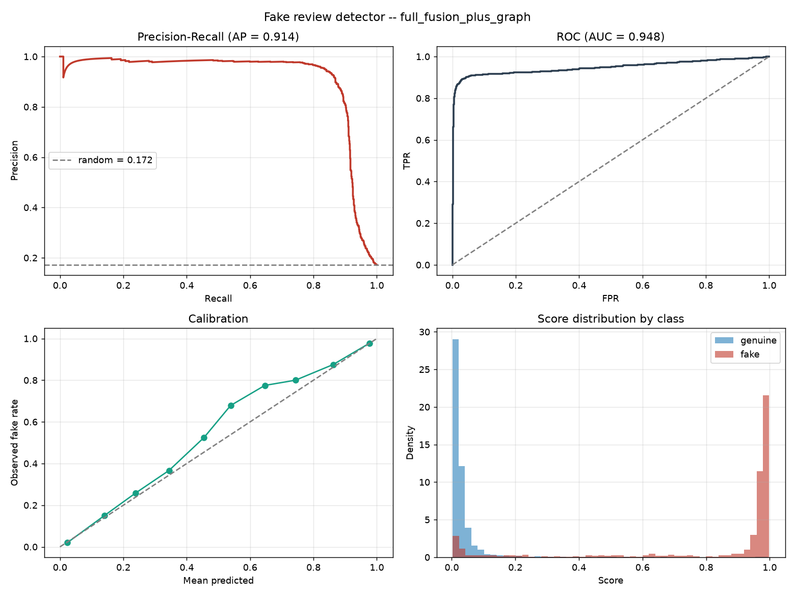

# Fake Review Detector

Detects paid, incentivised, and machine-generated reviews on an e-commerce
marketplace. Fuses **what a review says** with **how it arrived** — because a
single glowing 5-star post is unremarkable, while forty of them on one product
inside six hours from accounts that each post four reviews a day is not.

Runs end to end on a laptop with no data downloads: a synthetic marketplace
generator ships with the project, and real corpora plug in through one adapter.

```
Review text ──▶ TF-IDF word+char ──▶ LogisticRegression ──▶ text_score ──┐
                                                                          │
Reviewer & product history ──▶ 31 causal behavioural features ────────────┤
                                                                          ├──▶ GBDT ──▶ calibrated P(fake) ──▶ tiered action
Reviewer↔product co-review graph ──▶ 18 causal graph features ────────────┤
                                                                          │
Review text ──▶ 46 linguistic/stylometric features ──────────────────────┘
```

---

## Quickstart

```bash
make setup      # venv + editable install  (macOS also: brew install libomp)
make dataset    # synthesise 40k reviews with embedded review-farm campaigns
make train      # 8 ablations x 2 split regimes; saves the best model
make test       # 82 tests, including the two no-leakage proofs
make serve      # scoring API on :8000, interactive docs at /docs
```

Score one review from the command line:

```bash
.venv/bin/python -m frd.cli.score --text "Amazing product! Best ever! Highly recommend!"
```

---

## Results

40,000 synthetic reviews · 19.3% inauthentic · 5,005 accounts · 888 products ·
**temporal split** (train on the past, test on the future) · 28k train / 6k val
/ 6k test.

### The ablation is the interesting part

| Model | Features | Test PR-AUC | P@2% | Precision | Recall |
|---|---|---|---|---|---|
| `text_only` | TF-IDF word + char | 0.813 | 0.967 | 0.889 | 0.746 |
| `linguistic_only` | 46 stylometric | 0.830 | 0.967 | 0.897 | 0.686 |
| `behaviour_only` | 31 causal behavioural | **0.887** | 0.992 | 0.893 | 0.746 |
| `graph_only` | 18 causal co-review graph | 0.526 | 0.750 | 0.750 | 0.099 |
| `text_plus_linguistic` | both text families | 0.862 | 0.967 | 0.893 | 0.771 |
| `full_fusion` | text + linguistic + behaviour | 0.910 | 0.967 | 0.893 | 0.877 |
| `behaviour_plus_graph` | behaviour + graph | 0.886 | 0.983 | 0.886 | 0.741 |
| **`full_fusion_plus_graph`** | **all four** | **0.914** | **0.992** | 0.888 | 0.878 |

Random-ranking PR-AUC is 0.172, so the fused model is a **5.31× lift**;
ROC-AUC 0.948, Brier 0.031.

**The finding that matters: behaviour alone (0.887) beats both text families
combined (0.862).** *How* a review arrived carries more signal than what it
says — which is why the causal-feature machinery exists and why the no-leakage
proof is load-bearing. Fusion still wins, so text is not redundant; it is the
weaker half.

**The second finding: the graph block barely pays.** It adds **+0.004** PR-AUC
to the fused model and carries 5.1% of stage-B feature importance. It does move
P@2% from 0.967 to 0.992, which is worth having when a moderation queue can
only absorb the top 2% of daily volume — but anyone expecting graph features to
be transformative should read that table row again. On this corpus the
behavioural burst features already catch the campaigns the graph would catch,
because a campaign *is* a burst. The graph should pay for itself against farms
that pace themselves below burst thresholds; that is a claim only real data can
settle. `graph_only` at 0.526 is the honest measure of how little the structure
carries on its own.

**And it does not fix cold start, which is what it was built for.**
`docs/ROADMAP.md` predicted graph features would be the answer to the
no-history slice. Measured, they move it from 0.034 to 0.038 PR-AUC — nothing.
The reason is structural and should have been obvious in advance: **an account
with no history has no edges either.** The graph is exactly as empty as the
behavioural counters, for the same reason.

Sanity check on the same data with a **cold-reviewer** split (no account shared
between train and test): fused PR-AUC 0.905. Performance survives unseen
accounts, so the model is not a memorised blocklist. The graph block does
better here than on the temporal split (`graph_only` 0.605 against 0.526),
which is the one result that behaves as the roadmap predicted: structure
generalises to accounts the model has never seen, because it describes the
company an account keeps rather than the account itself.

### Choosing an operating point

Per 10,000 reviews/day, on test:

| Threshold | Precision | Recall | Flagged/day | False accusations/day | Missed fakes/day |
|---|---|---|---|---|---|
| 0.10 | 0.776 | 0.906 | 2008 | 450 | 162 |
| 0.15 | 0.842 | 0.893 | 1825 | 288 | 183 |
| **0.30** | **0.916** | **0.866** | **1627** | **137** | **230** |
| 0.50 | 0.951 | 0.835 | 1510 | 73 | 283 |
| 0.90 | 0.977 | 0.744 | 1310 | 30 | 440 |

Moving 0.15 → 0.30 removes 151 false accusations a day and costs 47 extra
misses. That is the trade the threshold policy exists to make explicit.

Queue quality at the top is high: **P@1% = 0.983, P@2% = 0.992, P@5% = 0.980** —
if moderators can only review the top 5% of daily volume, essentially all of it
is fraud.

### Where it fails (the slices that matter)

| Slice | n | Base rate | PR-AUC | Lift | Recall |
|---|---|---|---|---|---|
| Author has 10+ prior reviews | 3994 | 0.246 | 0.943 | 3.8× | 0.912 |
| Author has 3–9 prior reviews | 1203 | 0.030 | 0.326 | 10.9× | 0.278 |
| **Author has 1–2 prior reviews** | 578 | 0.014 | **0.012** | **0.9×** | **0.000** |
| **Author has no history (cold)** | 225 | 0.027 | **0.038** | **1.4×** | **0.000** |
| Verified purchase | 4269 | 0.084 | 0.805 | 9.6× | 0.734 |
| Not verified | 1731 | 0.390 | 0.962 | 2.5× | 0.954 |
| 2–3 star rating | 2002 | 0.048 | 0.571 | 11.9× | 0.521 |

Read **lift**, not raw PR-AUC, across these rows — 0.33 on a 3%-positive slice
is 11× better than random, while 0.33 on a 40%-positive slice would be worse
than random. Three honest weaknesses:

1. **Cold start is a failure, not a weakness.** With 0–2 prior reviews the
   model recalls **nothing** at the operating threshold, and the 1–2 slice sits
   at 0.9× lift — *worse than random ranking*. Both slices are small (225 and
   578 rows, single-digit positives), so the exact numbers are noisy; the
   direction is not. Graph features were supposed to fix this and do not, for
   the reason given above: an account with no history has no edges either.
2. **Established-looking accounts are where the volume is.** The 10+ slice
   carries 67% of test rows and a 24.6% base rate, and the model handles it
   well (0.943, recall 0.912) — but a farm that patiently ages its roster
   before working it is buying its way into the slice the model treats most
   confidently.
3. **Verified fakes.** Refund-for-review schemes produce *verified* purchases;
   PR-AUC drops from 0.962 to 0.805 when the verified badge is present.

None of these are visible in the headline number, which is why the slice table
is generated on every run.

**A false-positive check worth doing.** Because "no prior history" correlates
with fraud in training, there is a real risk the model flags every genuine
first-time reviewer. Measured directly, holding text constant and varying only
the supplied history:

| Author context | Specific/measured text | Promotional text |
|---|---|---|
| None (cold start) | 0.019 | 0.977 |
| 3 benign prior reviews | 0.093 | 0.988 |
| 8 benign prior reviews | 0.088 | 0.987 |
| 8 prior, all 5★ unverified | 0.043 | 0.986 |

A genuine first review scores **0.019 against a 0.217 threshold** — an order of
magnitude clear of it — while the same account posting promotional text scores
0.977. Text drives the decision, which is the desired behaviour, and the cold
column is the *lowest* in the table rather than the highest.
`test_genuine_first_time_reviewer_is_not_flagged` locks it in.

Read this next to the cold-start slice above and the two say something
consistent: the model is not biased *against* new accounts, it is simply blind
on them. Those are different failures, and only one of them harms a customer.



The precision-recall curve holds ~98% precision out to about 0.85 recall and
then falls off a cliff just past 0.9, and the score histogram is sharply
bimodal — genuine reviews pile up under 0.05, fakes against 1.0, with very
little in between. Both say the same thing: coordinated campaigns are caught
almost perfectly, and the sophisticated lone-wolf fakes are nearly invisible.
The average hides two very different populations, and the cliff is where one
ends and the other begins.

The calibration panel sits slightly *above* the diagonal through the middle of
the range: in the 0.4–0.7 band the model is mildly under-confident, and the
true fake rate is a few points higher than the score claims. Mean absolute
calibration gap is 0.046. That direction is the safe one for this application —
it under-states rather than over-states the case for removing a review.


---

## What makes this more than a text classifier

**1. Behavioural features, computed causally — and proven so.**
The strongest signals are contextual: how fast the author posts, how similar
this text is to their last one, whether the product's review volume just spiked
20×. Computing those wrongly is the single most common way fake-review projects
inflate their results — a reviewer average taken over the whole dataset encodes
the future into the past.

Every feature here may use only reviews *strictly earlier* than the one being
scored. `tests/test_causality.py` recomputes features on a corpus truncated at
row *i* and asserts row *i*'s vector is bit-identical to its value from the full
corpus. A feature that peeked forward fails the test.
`tests/test_graph.py` applies the identical proof to the graph block, where the
obligation is sharper: a graph statistic is assembled from edges contributed by
*other* accounts, so "did this row see the future" cannot be eyeballed the way
a per-reviewer counter can.

**2. A co-review graph that is streamed, not embedded.** The roadmap called for
node2vec or GNN embeddings. Taken literally that is a leak: an embedding fitted
to the finished graph gives every node a vector summarising all the edges that
account will *ever* have, so a January review arrives carrying next March's
behaviour — the whole-dataset average again, laundered through 128 dimensions
where nobody would spot it. `features/graph.py` instead maintains neighbourhood
overlap, union-find components and cohort density incrementally, in one
chronological pass, and submits them to the truncation proof. Overlap is
weighted by how obscure the shared product was: co-reviewing a bestseller is
not evidence, co-reviewing something nine people bought is.

**3. No random splits.** A random split puts the same campaign on both sides,
so the model recognises a template it trained on. Two regimes are reported
instead: **temporal** (train on the past, test on the future — the
production-realistic number) and **cold-reviewer** (disjoint accounts — proves
the model is not just a memorised blocklist).

**4. Negative controls.** `tests/test_leakage.py` asserts the pipeline *cannot*
find signal that does not exist: shuffled labels must collapse PR-AUC to the
base rate. Without this, a leakage bug reads as a great result.

**5. The threshold is a policy decision.** Nothing about 0.5 reflects that
wrongly deleting a real customer's review costs more than missing a fake one.
The threshold is set to the lowest value whose validation precision meets a
target (default 90%), and the model emits three tiers — `auto_remove`,
`queue_for_review`, `allow` — with `threshold_table()` printing the whole
frontier as moderator workload per 10k reviews.

**6. Explanations a moderator can act on.** Exact tree-SHAP feature
contributions, exact linear token contributions, and curated English reason
codes:

```json
{
  "score": 0.94, "decision": "auto_remove",
  "reasons": [
    "Author posted 9 reviews in a 24-hour window",
    "Text is 96% similar to another review on this product",
    "Product's review volume is 18.4x its weekly average",
    "68% of this product's recent reviewer pairs have reviewed together before",
    "Only 12% of the author's past reviews were verified purchases"
  ]
}
```

**7. No training/serving skew.** The API does not reimplement feature logic —
it assembles context plus the target review into a frame and calls the *same*
functions training used. `test_api_and_offline_scores_agree` asserts both paths
return the same number to 1e-6.

---

## Signals the model uses

**Behavioural (31)** — reviewer burst counts (24h/7d/peak), account tenure and
posting rate, rating extremity, template self-similarity, product-review spike
ratio, rating deviation from the product mean, verified-purchase share,
fresh-account share of recent product reviews, overnight-posting share,
category entropy.

**Graph (18)** — the reviewer↔product bipartite graph, projected onto its
reviewer side. Neighbourhood overlap normalised by how much each account posts
(Jaccard) and by how obscure the shared products were (Adamic–Adar), the size
and density of the strong-tie component an account sits in, how many of a
product's existing reviewers the author has worked alongside before, how
cliquish that product's recent cohort is, and how often two accounts keep
landing inside the same 48-hour window. The normalisation is the whole game:
counted raw, these features detect *enthusiasm* — see `_surprise()` in
`features/graph.py` for the measured failure that motivated it.

**Linguistic (46)** — the core hypothesis is **specificity**. Real customers
cite concrete detail ("measured 31cm not the 29cm listed", "ran 6 hours not the
advertised 9"); paid reviewers produce superlative density with no detail. So
numerals, measurement units, comparatives and hedges count *for* authenticity,
while superlative/intensifier density and stock promo phrases count against it.

**Text** — TF-IDF word (1,2) and character (3,5) n-grams. Character n-grams
matter because farms paraphrase and inject typos specifically to beat
exact-duplicate filters; word n-grams break under those edits, character
n-grams survive them.

---

## Project layout

```
src/frd/
  schema.py               canonical review schema; every source normalises into it
  config.py               all paths and hyper-parameters
  data/
    synth.py              synthetic marketplace: farm rosters, cover traffic,
                          campaigns, label noise
    loaders.py            adapters for real corpora + coverage reporting
    splits.py             temporal and cold-reviewer splits (no random split)
  features/
    behavior.py           31 strictly-backward-looking behavioural features
    graph.py              18 streaming co-review graph features
    text.py               46 stylometric features + TF-IDF vectorisers
  models/
    pipeline.py           two-stage stacked detector, ablation-configurable
    transformer.py        optional DistilBERT stage (lazy imports)
  evaluate.py             PR-AUC, precision@k, threshold frontier, slices
  explain.py              tree-SHAP + token contributions + reason codes
  api/                    FastAPI scoring service
  cli/                    make_dataset / train / score
tests/                    82 tests incl. two causality proofs + negative controls
docs/
  METHODOLOGY.md          why each decision was made; the leakage analysis
  ROADMAP.md              the phases, what is done, what is next
  MODEL_CARD.md           intended use, limitations, ethical considerations
```

---

## Using real data

```python
from frd.data.loaders import load_generic, describe_coverage

df = load_generic("reviews.csv", column_map={
    "id": "review_id", "asin": "product_id", "author": "reviewer_id",
    "stars": "rating", "body": "text", "created_at": "timestamp",
})
print(describe_coverage(df))   # tells you if behavioural features are usable
```

`describe_coverage` matters: several popular public fake-review corpora have no
reviewer id and no timestamp, so every behavioural feature degenerates to a
constant and you are training a pure text classifier. It says so explicitly
rather than letting you report inflated numbers.

---

## Honest limitations

- **The reported numbers are on synthetic data**, and the generator was revised
  partway through this work — farms given reusable account rosters, farm
  accounts given genuine cover traffic — which moved every number in the table
  above. `docs/METHODOLOGY.md` §5.1 publishes the before and after side by side,
  because "we changed the data and the new feature started working" is a claim
  that has to be auditable. The numbers prove the pipeline is
  correct, causal, and skew-free — not that the model will hit them on
  your marketplace. Re-measuring on labelled production data is Phase 6 of
  `docs/ROADMAP.md`, and the highest-value next step.
- **Cold-start is a failure, and graph features did not fix it.** With no author
  or product history the model recalls nothing at the operating threshold. This
  was the roadmap's headline argument for building the graph block, and
  measuring it settled the question the other way: an account with no history
  has no edges either, so the graph is empty for exactly the same reason the
  behavioural counters are. Detecting a first-ever review needs a signal that
  exists before the account acts — device, payment instrument, registration
  fingerprint — none of which the review schema carries.
- **Concept drift is guaranteed.** Fraud tactics change; scheduled retraining
  and drift monitoring are not optional.
- **Fairness risk is specific and real.** Terse, unhedged, superlative-heavy
  text is also what a non-native English speaker writes. The specificity
  features could systematically disadvantage them. Measure flag rates by
  writing-style proxy before deploying.

See `docs/METHODOLOGY.md` for the full analysis and `docs/MODEL_CARD.md` for
intended use.
